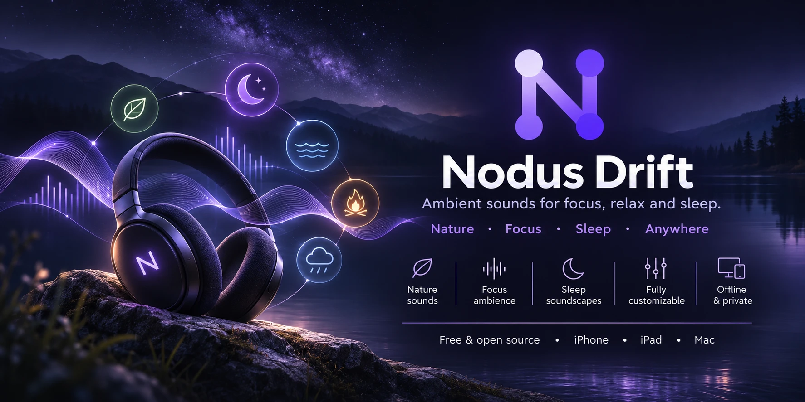
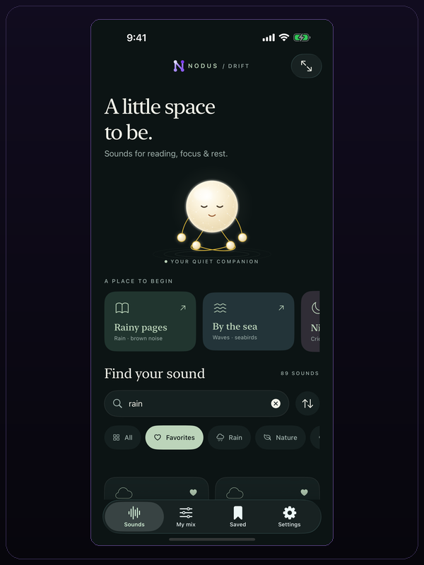
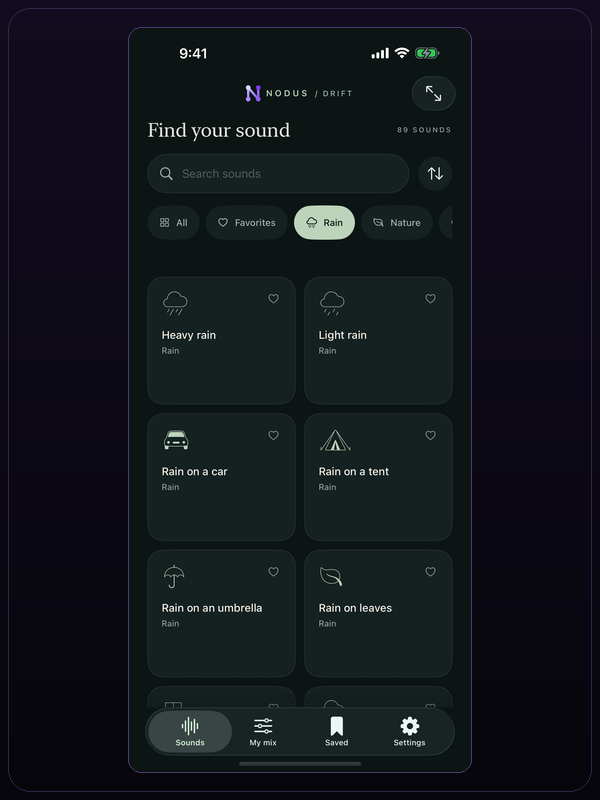
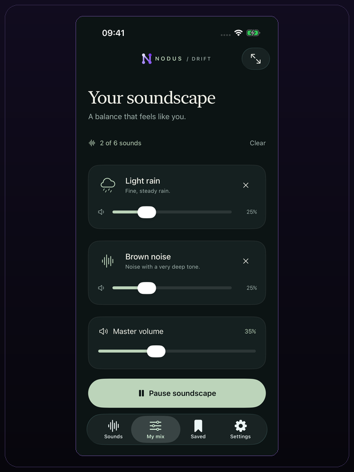
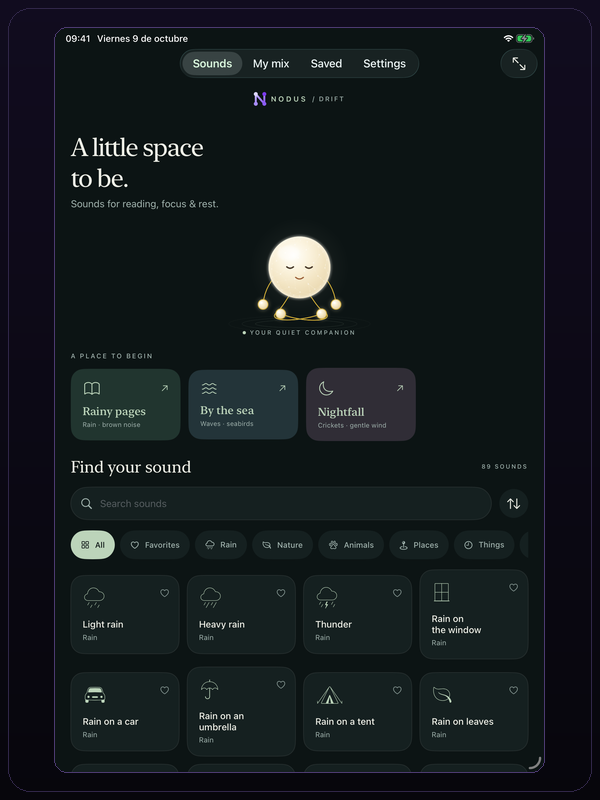
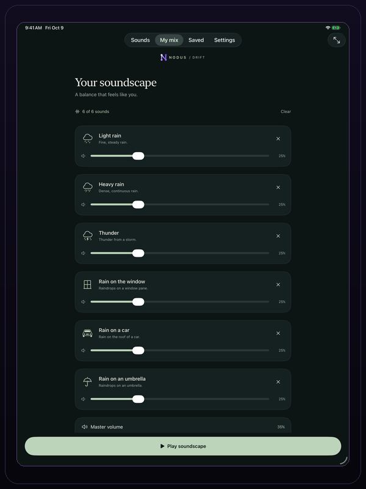
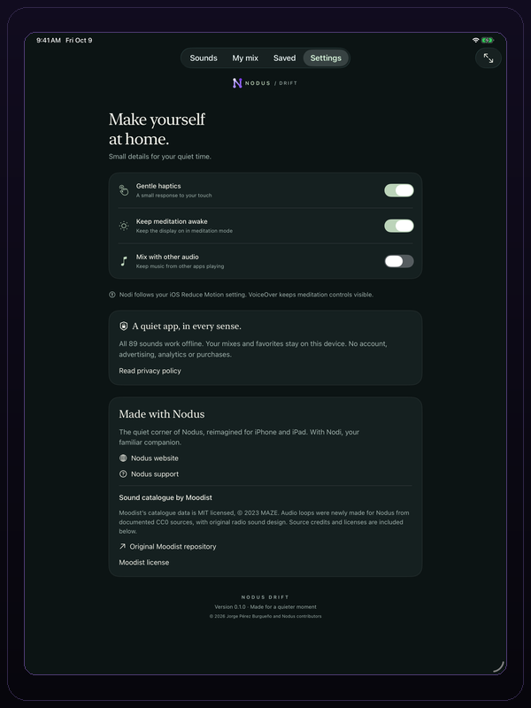

  

  

# Nodus Drift

Nodus Drift is a free, open-source app for listening to ambient sounds and creating immersive soundscapes on iPhone and iPad. It includes 89 offline sounds, simple mixes of up to six sounds, and a Studio for scenes of up to 12 layers. There are no ads, tracking, subscriptions or purchases. Optional model downloads use your Hugging Face account; listening and manual creation work without an account.

It is built with SwiftUI and AVAudioEngine. Audio is decoded, mixed and played on the device.

Download Nodus Drift on the [App Store](https://apps.apple.com/app/nodus-drift-ambient-sounds/id6820753637) for iPhone and iPad. It requires iOS 17 or iPadOS 17 or later.

## Features

- **Soundscape Studio:** create and save scenes with up to 12 layers, intensity and
  position keyframes, random events, fades, a timeline and an interactive spatial map.
  Three evolving starter scenes are included; simple listening remains available.
- **Portable scenes:** edit, duplicate, import, export and share scene documents
  including their locally generated recordings.
- **Local audio generation:** optional Stable Audio 3 Small-SFX and Small-Music
  models, reusing Reader's StableAudioMLX runtime. Downloads use your Hugging Face
  read token, stored in Keychain. Weights have separate Stability/Gemma terms.
  Generation runs on supported physical devices and is disabled in Simulator.
- **Create with words:** Apple's optional on-device Foundation Models framework
  directs editable scenes on eligible iOS 26+ devices. No external AI fallback.
- **Living landscapes:** 22 bundled photographic-style environments with native
  Metal water, foliage, rain, snow, mist, firelight and stars. Selected animals,
  objects, footprints and windshield effects form personalized compositions. Weather follows scene
  automation. Visuals work offline, can be disabled, and respect Reduce Motion,
  Low Power Mode, visibility and thermal state.

- **Sound catalogue:** 89 sounds in Rain, Nature, Animals, Places, Things, Transport, Urban, Noise and Binaural categories.
- **Mixing:** play up to six sounds at once. Each sound has its own volume, and a master volume controls the mix. Gain changes use 150 ms ramps and the output passes through a peak limiter.
- **Playback:** seamless loops, independent stereo white, pink and brown noise, and five binaural presets. Audio playback continues in the background with lock-screen controls.
- **Discovery:** search sounds, mark favorites, filter by category and sort by recommended order, name, type or use count.
- **Saved mixes:** save up to 48 mixes with a name, icon, sounds and volumes. Edit or delete them at any time. Restored mixes start paused.
- **Sleep timer:** stop playback after a chosen number of minutes. Playback fades out when the timer ends, including while the screen is locked.
- **Meditation:** choose the original Nodi companion or an animated personalized landscape
  based on the sounds in your mix. Pause visuals independently of audio; your
  appearance choice is remembered. A clean immersive view keeps only the small
  top-left Nodus Drift brand visible until tapped. Nodi keeps its lotus pose and breathing animation.
- **Accessibility:** VoiceOver labels and actions, Reduce Motion support, adaptive grids and native controls.
- **Offline use:** all sounds, favorites, mixes and settings are stored on the device. No account or server is required.

## Sound library

The app contains 89 sounds. The counts below match the bundled catalogue.

| Category | Sounds | Examples |
| --- | ---: | --- |
| Rain | 8 | Light rain, heavy rain, thunder, rain on a window or tent |
| Nature | 12 | River, waves, campfire, wind, forest |
| Animals | 16 | Birds, seagulls, crickets, wolf, owl |
| Places | 16 | Café, airport, church, temple, construction site |
| Things | 16 | Keyboard, typewriter, paper, clock, wind chimes |
| Transport | 6 | Train, airplane, submarine, sailboat |
| Urban | 7 | Highway, road, ambulance siren, busy street, crowd |
| Noise | 3 | White noise, pink noise, brown noise |
| Binaural | 5 | Delta 2 Hz, Theta 5 Hz, Alpha 10 Hz, Beta 20 Hz, Gamma 40 Hz |

Binaural presets use a 100 Hz carrier. Use stereo headphones; play one binaural preset at a time. The other categories can be mixed together.

## Mixes and playback

- A mix can contain up to six sounds. The current mix is shown in **My mix**, where each sound and the master output can be adjusted.
- Starter mixes provide a quick way to begin. **Rainy pages** combines light rain and brown noise; **By the sea** combines waves and seabirds.
- Up to 48 mixes can be saved. A saved mix stores its name, icon, sound selection and volume levels.
- The player supports background audio, lock-screen controls, a sleep timer and optional haptics.
- The meditating Nodi view provides a full-screen scene. It respects Reduce Motion and keeps controls available to VoiceOver.
- All mixing and playback are local. The app does not send listening data to a server.

## Screenshots

All screenshots use the same 600 × 800 frame.

### iOS

| Home | Sounds | My mix |
| :---: | :---: | :---: |
|  |  |  |

### iPadOS

| Home | My mix | Settings |
| :---: | :---: | :---: |
|  |  |  |

### macOS

To use the Nodus Drift experience on macOS, install the original [Nodus Research](https://github.com/jorgepb96/nodus) app.

Nodus Drift is licensed under the MIT licence. See [docs/LICENSING.md](docs/LICENSING.md) for the licence scope and [docs/rights](docs/rights) for the audio source register. Moodist catalogue data is MIT licensed.

Studio architecture, evidence and limitations are recorded in
[docs/soundscape-studio](docs/soundscape-studio/ARCHITECTURE.md). The feasibility
measurements are from Reader; at the user's request no new physical iPhone tests
were performed for Studio. See [feasibility](docs/soundscape-studio/FEASIBILITY.md)
and [validation](docs/soundscape-studio/VALIDATION.md).

Immersive scenes show the main photograph and animated atmosphere. Decorative
animal/object overlays are disabled; their assets and recipes are retained.
Every environment includes a dedicated horizontal photograph. The mini player
opens the landscape for the current mix or Studio scene. See
[horizontal landscapes](docs/soundscape-studio/BUILD16_HORIZONTAL_LANDSCAPES.md)
and the [0.2.0 (17) library layout correction](docs/soundscape-studio/BUILD17_LANDSCAPE_LIBRARY.md)
for implementation and validation.

CarPlay Audio provides Home, saved mixes/Studio scenes and Explore using native
static-artwork grids, with the system Now Playing screen and one shared audio
transport. Editing and animated landscapes remain on iPhone. See
[implementation and signing](docs/carplay/IMPLEMENTATION.md) and
[validation and remaining vehicle checks](docs/carplay/VALIDATION.md).
