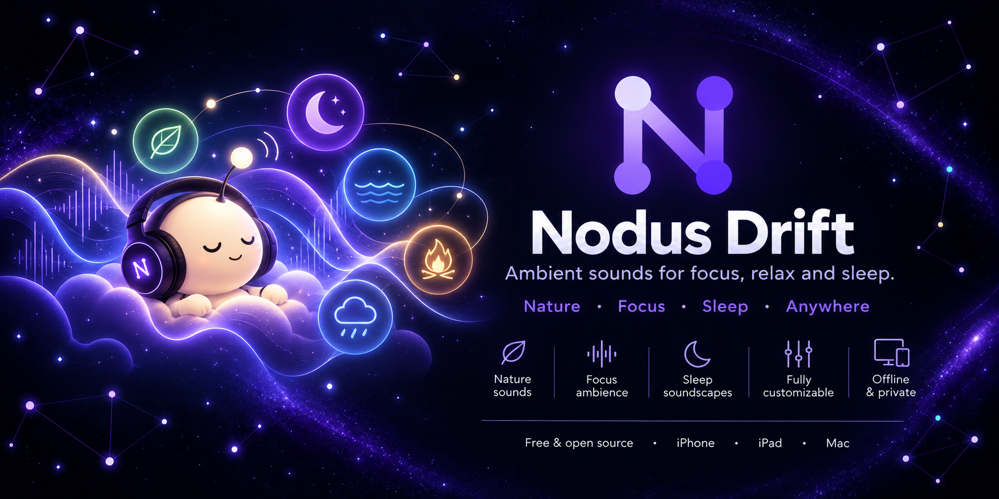
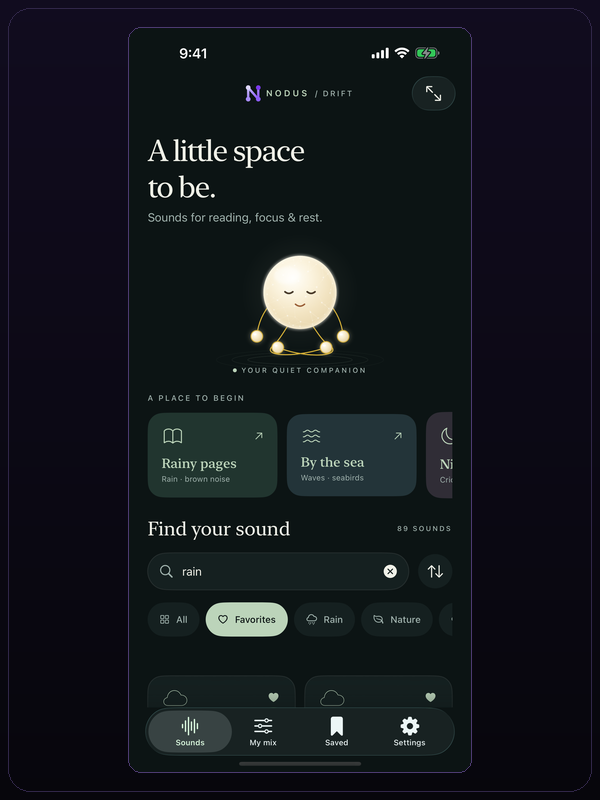
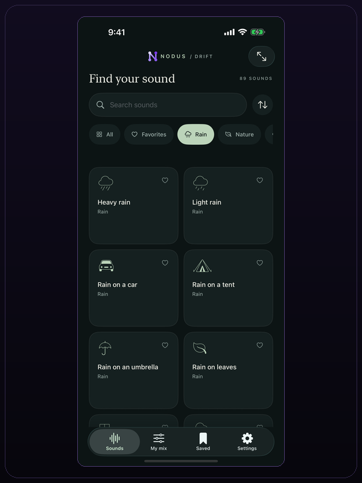
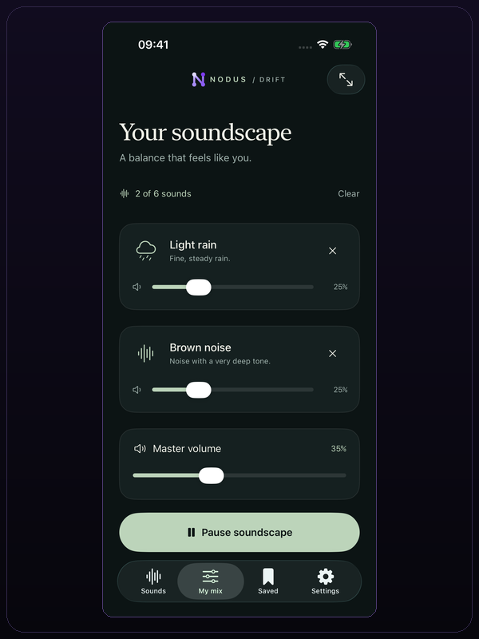
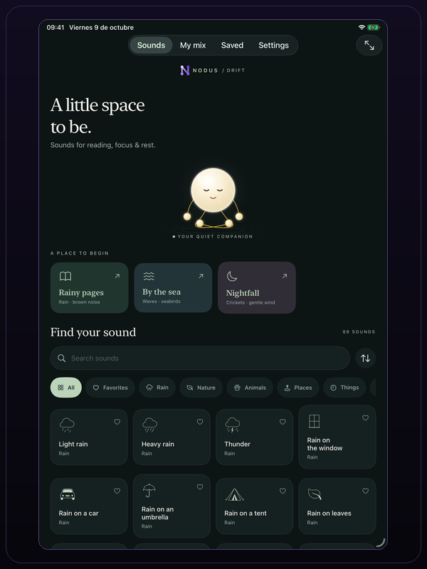
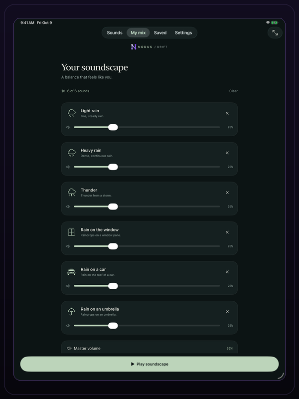
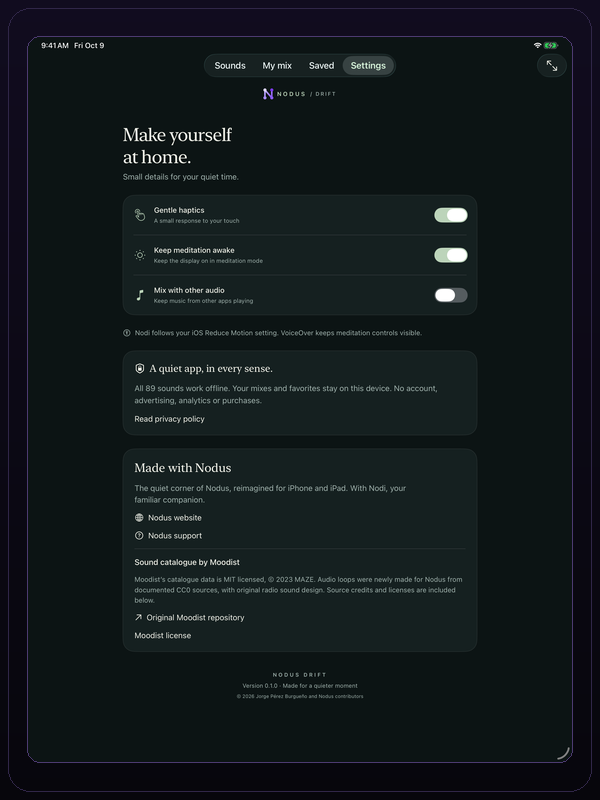

  

  

# Nodus Drift

Nodus Drift is a free, open-source app for playing ambient sounds on iPhone and iPad. It includes 89 sounds, supports mixes of up to six sounds, and works without a network connection. There are no accounts, ads, tracking, subscriptions or purchases.

It is built with SwiftUI and AVAudioEngine. Audio is decoded, mixed and played on the device.

The public beta is available on [TestFlight](https://testflight.apple.com/join/kAXnsjJS). The current mobile release supports iPhone and iPad on iOS 17 or later.

## Features

- **Sound catalogue:** 89 sounds in Rain, Nature, Animals, Places, Things, Transport, Urban, Noise and Binaural categories.
- **Mixing:** play up to six sounds at once. Each sound has its own volume, and a master volume controls the mix. Gain changes use 150 ms ramps and the output passes through a peak limiter.
- **Playback:** seamless loops, independent stereo white, pink and brown noise, and five binaural presets. Audio playback continues in the background with lock-screen controls.
- **Discovery:** search sounds, mark favorites, filter by category and sort by recommended order, name, type or use count.
- **Saved mixes:** save up to 48 mixes with a name, icon, sounds and volumes. Edit or delete them at any time. Restored mixes start paused.
- **Sleep timer:** stop playback after a chosen number of minutes. Playback fades out when the timer ends, including while the screen is locked.
- **Nodi:** an animated Nodus character with a lotus pose, breathing animation and a full-screen meditation view.
- **Accessibility:** VoiceOver labels and actions, Reduce Motion support, adaptive grids and native controls.
- **Offline use:** all sounds, favorites, mixes and settings are stored on the device. No account or server is required.

## Sound library

The app contains 89 sounds. The counts below match the bundled catalogue.

| Category | Sounds | Examples |
| --- | ---: | --- |
| Rain | 8 | Light rain, heavy rain, thunder, rain on a window or tent |
| Nature | 12 | River, waves, campfire, wind, forest |
| Animals | 16 | Birds, seagulls, crickets, wolf, owl |
| Places | 16 | Café, airport, church, temple, construction site |
| Things | 16 | Keyboard, typewriter, paper, clock, wind chimes |
| Transport | 6 | Train, airplane, submarine, sailboat |
| Urban | 7 | Highway, road, ambulance siren, busy street, crowd |
| Noise | 3 | White noise, pink noise, brown noise |
| Binaural | 5 | Delta 2 Hz, Theta 5 Hz, Alpha 10 Hz, Beta 20 Hz, Gamma 40 Hz |

Binaural presets use a 100 Hz carrier. Use stereo headphones; play one binaural preset at a time. The other categories can be mixed together.

## Mixes and playback

- A mix can contain up to six sounds. The current mix is shown in **My mix**, where each sound and the master output can be adjusted.
- Starter mixes provide a quick way to begin. **Rainy pages** combines light rain and brown noise; **By the sea** combines waves and seabirds.
- Up to 48 mixes can be saved. A saved mix stores its name, icon, sound selection and volume levels.
- The player supports background audio, lock-screen controls, a sleep timer and optional haptics.
- The meditating Nodi view provides a full-screen scene. It respects Reduce Motion and keeps controls available to VoiceOver.
- All mixing and playback are local. The app does not send listening data to a server.

## Screenshots

All screenshots use the same 600 × 800 frame.

### iOS

| Home | Sounds | My mix |
| :---: | :---: | :---: |
|  |  |  |

### iPadOS

| Home | My mix | Settings |
| :---: | :---: | :---: |
|  |  |  |

### macOS

To use the Nodus Drift experience on macOS, install the original [Nodus Research](https://github.com/jorgepb96/nodus) app.

Nodus Drift is licensed under the MIT licence. See [docs/LICENSING.md](docs/LICENSING.md) for the licence scope and [docs/rights](docs/rights) for the audio source register. Moodist catalogue data is MIT licensed.
