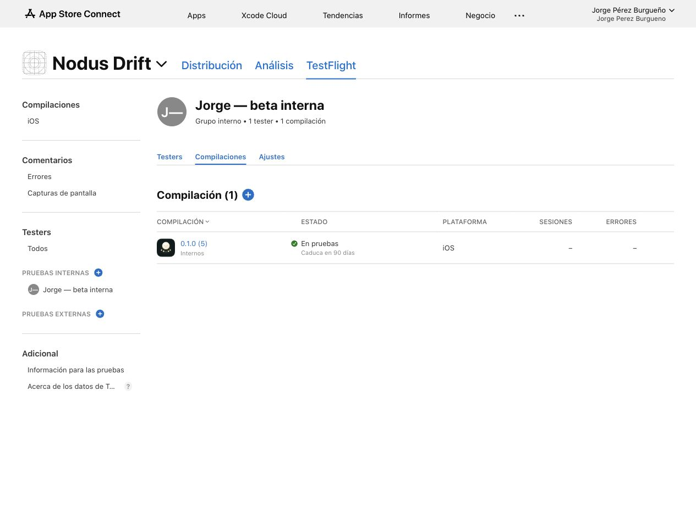

# Internal TestFlight beta

The current version **0.1.0 (5)** was archived, signed and uploaded on October 9, 2026.
Apple completed processing and App Store Connect shows **En pruebas / Testing**.
It is assigned to **Jorge — beta interna**, containing only the account holder.
The account holder has installed the previous 1.0.0 (1) build on an iPhone.
Installation of 0.1.0 (5) has not been verified; select this version in TestFlight.
Test instructions and the beta description are saved in English.

## Description and screenshots updated October 9

The English (US) beta description was saved in App Store Connect, and the build's
What to Test instructions were updated. Their exact text is preserved in
[TESTFLIGHT_DESCRIPTION.txt](TESTFLIGHT_DESCRIPTION.txt) and
[TESTFLIGHT_NOTES.txt](TESTFLIGHT_NOTES.txt).

Eighteen real screenshots were uploaded to the English (US) App Store draft,
initially version 1.0 and now corrected to 0.1.0: six for the medium Dynamic Island
iPhone, six for the large Dynamic Island
iPhone, and six for the 13-inch iPad. Each set presents the home library, mixer,
saved mixes, resting Nodi, awake Nodi and selected rain sounds, in that order.
The draft description and promotional text were also saved. See
[TESTFLIGHT_METADATA.md](TESTFLIGHT_METADATA.md) for sizes, source files and proof.

The existing Show approved screenshots and category option remains enabled.
[Apple uses screenshots from the latest approved Ready for Distribution version](https://developer.apple.com/help/app-store-connect/test-a-beta-version/provide-test-information/)
for TestFlight. This app has no such version yet, so the uploaded draft screenshots
are prepared for that later approval and do not appear in the current beta.
The beta description and What to Test text can already be shown by TestFlight.

The initial metadata update did not upload another binary. The later version
correction uploaded 0.1.0 (2), as recorded below. The draft was not submitted for review.

- App Store ID: `6820753637`
- Bundle ID: `com.drakonis96.nodusdrift`
- Signing team: `6RPLS9EA4X`
- Build: `0.1.0 (5)`
- Scope: **TestFlight internal testing only**
- Automatic distribution of future builds: disabled
- Current upload completed: October 9, 2026, 11:07:35 Europe/Madrid
- [Build in App Store Connect](https://appstoreconnect.apple.com/teams/36804ede-f0b5-4cd2-a273-c619feb6168f/apps/6820753637/testflight/ios/0db78c13-67bd-42d4-8c55-a09d1ccc6e8c)
- [Internal group](https://appstoreconnect.apple.com/teams/36804ede-f0b5-4cd2-a273-c619feb6168f/apps/6820753637/testflight/groups/40f2ec9c-cccb-4c2d-b3ce-ce073515bc77)



## Install on the iPhone

Open TestFlight on the iPhone and select Nodus Drift 0.1.0 (5). Use the account
in the existing internal group. Reopen TestFlight if necessary to refresh the
available build. An invitation already accepted for this group remains valid.

Build 5 aligns Saved with My mix: shared heading and page scale, matching empty
Nodi and action sizes, larger saved-card details and roomier cards. The focused
iPhone and iPad parity tests passed, including saving and loading while paused.
A Debug guard prevented audio activation, and neither test pressed Play. No
playback test was performed. The instructions are in TESTFLIGHT_NOTES.txt.

## Repeatable distribution

```sh
python3 scripts/prepare_audio.py
xcodegen generate --spec ios/project.yml
xcodebuild -project ios/NodusDrift.xcodeproj -scheme NodusDrift \
  -configuration Release -destination 'generic/platform=iOS' \
  -archivePath .build/NodusDrift-0.1.0-5.xcarchive \
  -derivedDataPath .build/ArchiveDerivedData -allowProvisioningUpdates archive
xcodebuild -exportArchive -archivePath .build/NodusDrift-0.1.0-5.xcarchive \
  -exportOptionsPlist ios/ExportOptions-TestFlight.plist \
  -exportPath .build/TestFlightExport5 -allowProvisioningUpdates
```

For another upload, increase CURRENT_PROJECT_VERSION and use new archive/log paths.
The export destination is upload, so Xcode submits directly to Apple and need not
leave an IPA in exportPath. Wait for processing and assign the new build to the group
in App Store Connect. The signed archive, upload log and release record remain in
the ignored .build directory. No keys, certificates or profiles are versioned.

## Version history

The first upload was 1.0.0 (1), completed at 01:07:15 Europe/Madrid. Its original
instructions are preserved in TESTFLIGHT_NOTES_BUILD1.txt, and the original
Testing proof is screenshots/14-testflight-build1.jpg. The user corrected the
intended current version to 0.1.0. Build 2 was uploaded, processed and assigned to
the same internal group, with current instructions saved in English. Build 1
was removed from this group's available builds; its upload/archive history was
retained. Build 3 was uploaded at 10:16:20, processed and assigned to the same
internal group. At activation, its status was En pruebas / Testing. Build 2 was removed only from
the group, preserving its archive/upload history and ability to reassign it.
Build 2 notes remain in TESTFLIGHT_NOTES_BUILD2.txt. See VERSIONING.md for the
version source of truth. Build 4 was uploaded at 10:38:46 and activated in the
same group after its iPhone and iPad deep-filter checks passed. Build 3 was
removed only from the group; its archive and notes remain available. Historical
build 4 proof is screenshots/34-testflight-0.1.0-4-active.png, with saved English
notes in screenshots/33-testflight-0.1.0-4-notes.png. Build 5 was uploaded at
11:07:35 and activated in the same group after both Saved parity checks passed.
Build 4 was removed only from the group; its upload and notes are retained in
TESTFLIGHT_NOTES_BUILD4.txt. Current proof is
screenshots/41-testflight-0.1.0-5-active.png, with saved English notes in
screenshots/40-testflight-0.1.0-5-notes.png.

## Privacy and support

The app-specific policy is live at https://nodusresearch.com/drift/privacy/,
published through merged Nodus PR #1079 and successful Website deployment
37903966692. This URL was saved in App Store Connect. The product draft also
uses https://github.com/jorgepb96/nodus/issues for support and
https://nodusresearch.com/ for marketing. The No Data Collected privacy answer
is saved; final publication of that label requires the account holder
to authorize Apple’s explicit accuracy/update declaration.

## Public release remains separate

The current 0.1.0 (5) archive includes the historical Nodus MIT notice and its
Settings access added by the October 9 rights audit. The version label in Settings
reads the packaged app version. These changes compiled, and the signed package
was verified, including all 81 unchanged recordings and legal documents.
The release-rights decisions recorded in LICENSING.md remain pending.

No App Store review submission, external tester group or public TestFlight link was
created. The internal-only binary cannot be submitted to public App Store review.
Rights clearance described in LICENSING.md and the public release requirements in
APP_STORE.md remain pending; this testing upload does not establish new permissions.

## GitHub source

The native source, generated Xcode project, build scripts, legal notices, rights
audit, release documentation and real captures are versioned in
https://github.com/jorgepb96/nodus-drift-mobile on main. The existing repository
remains private. Audio recordings, signed archives, provisioning profiles and
credentials are excluded; prepare_audio.py reconstructs the pinned local assets.
