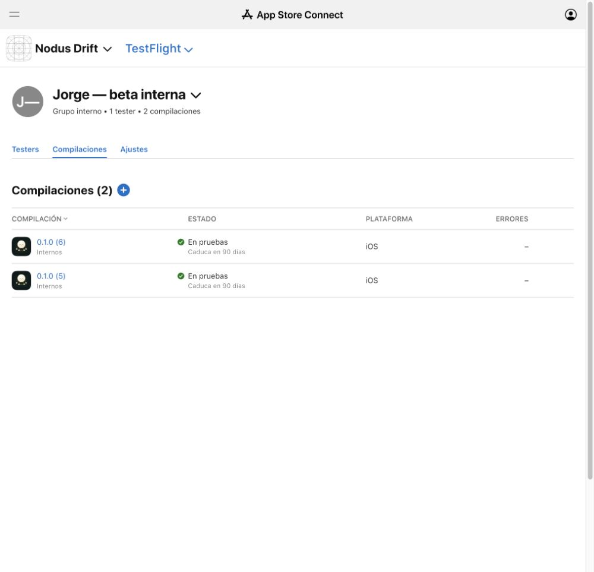

# Internal TestFlight beta

The current private beta is **0.1.0 (6)**. Its signed package was uploaded on
October 9, 2026 at **13:33:06 Europe/Madrid**. Apple completed processing and
App Store Connect shows **En pruebas / Testing** in **Jorge — beta interna**,
with only the account holder as tester. The current iPhone installation has not
been verified; choose 0.1.0 (6) in TestFlight.

Build 6 replaces **81/81** original Moodist audio files with newly produced loops.
Eighty options use 77 individually documented CC0 sources; radio tuning is
original Nodus synthesis without broadcast samples. All **89 options** remain,
as do saved-mix IDs, favorites and the eight native generators. Actual per-file
weights range from −0.1377% to +0.4299% versus build 5; the whole bank grows by
30,436 bytes. Source creators, individual licenses and production recipes are
recorded in [the replacement report](AUDIO_REPLACEMENT_2026-10-09.md) and in
Settings → Moodist license → Audio sources & permissions.

Five focused unit tests and four silent UI tests on each of iPhone and iPad
passed: **13/13** total. The native test decodes all 81 files and checks their
streaming joins. The signed package's catalogue, audio hashes, eight legal
notices, version and signature were verified. No audio output was activated;
no auditory review was performed. The owner will assess the loops by listening
on the private iPhone beta. See [VALIDATION.md](VALIDATION.md).

English What to Test notes are saved in App Store Connect and preserved in
[TESTFLIGHT_NOTES.txt](TESTFLIGHT_NOTES.txt). Build 5 notes remain in
[TESTFLIGHT_NOTES_BUILD5.txt](TESTFLIGHT_NOTES_BUILD5.txt). The existing beta
description and App Store draft screenshots remain as previously recorded in
[TESTFLIGHT_METADATA.md](TESTFLIGHT_METADATA.md); this release adds current
native audit captures under screenshots/43–47.

- App Store ID: `6820753637`
- Bundle ID: `com.drakonis96.nodusdrift`
- Signing team: `6RPLS9EA4X`
- Build: `0.1.0 (6)`
- Scope: **TestFlight internal testing only**
- [Current build](https://appstoreconnect.apple.com/teams/36804ede-f0b5-4cd2-a273-c619feb6168f/apps/6820753637/testflight/ios/d7e6bc52-a11e-47bb-aa51-8e448625b2a1)
- [Internal group](https://appstoreconnect.apple.com/teams/36804ede-f0b5-4cd2-a273-c619feb6168f/apps/6820753637/testflight/groups/40f2ec9c-cccb-4c2d-b3ce-ce073515bc77/builds)



## Install on the iPhone

Open TestFlight, select Nodus Drift and update to **0.1.0 (6)** using the existing
internal tester account. Reopen TestFlight to refresh available builds if needed.
The accepted invitation remains valid. Existing build 5 remains available for
comparison; the new replacement bank is in build 6. No new external invitation
or public link was created.

## Repeatable distribution

```sh
python3 scripts/prepare_audio.py
python3 scripts/audit_audio_bank.py
xcodegen generate --spec ios/project.yml
xcodebuild -project ios/NodusDrift.xcodeproj -scheme NodusDrift \
  -configuration Release -destination 'generic/platform=iOS' \
  -archivePath .build/NodusDrift-0.1.0-6.xcarchive \
  -derivedDataPath .build/Archive6DerivedData -allowProvisioningUpdates archive
xcodebuild -exportArchive -archivePath .build/NodusDrift-0.1.0-6.xcarchive \
  -exportOptionsPlist ios/ExportOptions-TestFlight.plist \
  -exportPath .build/TestFlightExport6 -allowProvisioningUpdates
```

For another upload, increase CURRENT_PROJECT_VERSION and use new archive/log paths.
Export submits directly to Apple; it need not leave an IPA. Verify processing and
internal group availability in the integrated browser. Signed archives, source WAVs,
MP3s, distribution logs and signing credentials stay excluded from Git.

## Version history

The first upload was 1.0.0 (1), completed at 01:07:15 Europe/Madrid. Its original
instructions are preserved in TESTFLIGHT_NOTES_BUILD1.txt, and the original
Testing proof is screenshots/14-testflight-build1.jpg. The user corrected the
intended current version to 0.1.0. Build 2 was uploaded, processed and assigned to
the same internal group, with current instructions saved in English. Build 1
was removed from this group's available builds; its upload/archive history was
retained. Build 3 was uploaded at 10:16:20, processed and assigned to the same
internal group. At activation, its status was En pruebas / Testing. Build 2 was removed only from
the group, preserving its archive/upload history and ability to reassign it.
Build 2 notes remain in TESTFLIGHT_NOTES_BUILD2.txt. See VERSIONING.md for the
version source of truth. Build 4 was uploaded at 10:38:46 and activated in the
same group after its iPhone and iPad deep-filter checks passed. Build 3 was
removed only from the group; its archive and notes remain available. Historical
build 4 proof is screenshots/34-testflight-0.1.0-4-active.png, with saved English
notes in screenshots/33-testflight-0.1.0-4-notes.png. Build 5 was uploaded at
11:07:35 and activated in the same group after both Saved parity checks passed.
Build 4 was removed only from the group; its upload and notes are retained in
TESTFLIGHT_NOTES_BUILD4.txt. Current proof is
screenshots/41-testflight-0.1.0-5-active.png, with saved English notes in
screenshots/40-testflight-0.1.0-5-notes.png.

## Privacy and scope

The app-specific policy is live at https://nodusresearch.com/drift/privacy/,
published through Nodus PR #1079 and saved in App Store Connect. The draft uses
https://github.com/jorgepb96/nodus/issues for support and https://nodusresearch.com/
for marketing. The saved No Data Collected answer still has its separate final
Apple accuracy/update declaration pending; this internal build did not publish it.

No App Store review submission, external tester group or public TestFlight link is
part of this update. The binary is internal-only. The removed Moodist-bank source
gaps are superseded by the new documented CC0 inputs; public first-party licensing
and recipient source access remain separate from this private test step.

## GitHub source

Native source, legal notices, original-source evidence, loop recipes, hashes,
size comparisons, tests, release documentation and captures are versioned in the
existing **private** repository https://github.com/jorgepb96/nodus-drift-mobile.
prepare_audio.py reconstructs the licensed replacement bank; it never downloads
the removed Moodist audio. The translation JSON is explicitly a draft, not shipped
localization: this internal release remains English-only.
