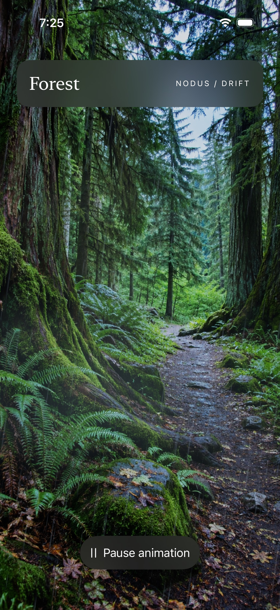
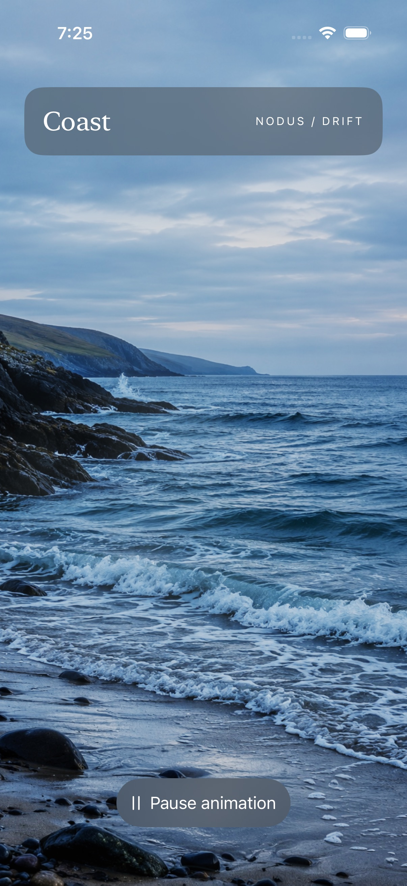
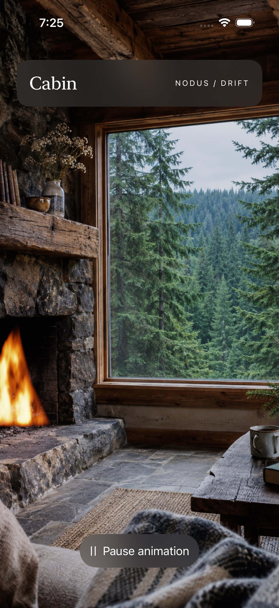
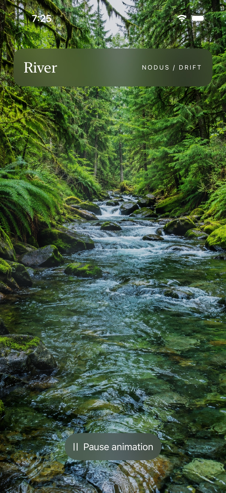
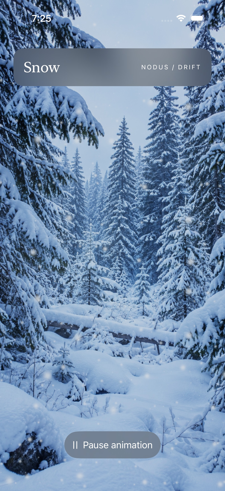
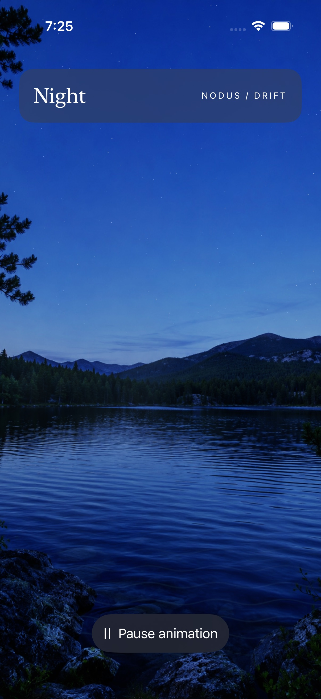

# Photographic landscapes

The scenery uses 22 original AI-generated photographic-style 1024 × 1536 JPEG
plates and two transparent 4 × 4 photographic animal/object PNG atlases. Together
the artwork adds 17,562,388 bytes (16.75 MiB). Environments cover wilderness,
car, tent, cafe, city, train, underwater, study, sanctuary, airport, utility room,
market, construction, fairground, laboratory and library. No visual assets or
image models are downloaded at runtime.
Generation used the built-in OpenAI image tool during development. Full prompts,
provenance and SHA-256 hashes are in [LANDSCAPE_ASSETS.json](LANDSCAPE_ASSETS.json).
The source originals remain in the generation tool's output directory; the app
uses only the workspace copies in `ios/NodusDrift/Resources/Landscapes/`.

## Rendering and motion

- SwiftUI hosts an MTKView over a native still-image fallback. Both preserve
  aspect-fill composition and opt out of accessibility color inversion for photos.
- The GPU reads JPEGs directly as sRGB textures. A CGImage thumbnail conversion
  produced wrong colors on this simulator; the production loader now has a real
  render/color regression check.
- Masks in original image coordinates keep the photographed hearth, window,
  riverbanks, shoreline and lake aligned across viewport crops. Green-material
  displacement adds restrained foliage motion. Water receives moving refraction
  and highlights; the entire image is never translated as a camera-pan substitute.
- Three precipitation depths vary speed, size and opacity. Rain falls only outside
  the cabin window. Snow has independent slow drift. Mist follows wind; fire has
  turbulent filaments, heat distortion, flickering bounce light and rare embers.
- Exposure, white balance and mist respond to the scene controls. Rain/wind/fire
  follow evaluated audio-layer intensity, including automation, fades and mute.
  Dawn follows scene time; thunder events trigger soft lighting pulses.
- These are animated photographs with local procedural effects, not recorded
  nature videos, a complete 3D simulation or arbitrary generated visual scenes.
  Shoreline surf does not advance as it would in recorded footage. Masks are
  calibrated to these bundled assets and must be reviewed if artwork changes.

## Resource policy

Rendering targets 30 fps with a drawable long edge capped at 2048 pixels. At most
two GPU command buffers are in flight; a busy renderer drops work rather than
blocking the UI. The shared texture cache retains at most two entries within a
48 MiB budget; each original texture is approximately 6 MiB before driver overhead.
Image loading is asynchronous for the GPU; a bounded native thumbnail remains
available as a fallback. Actual process memory includes the UI, driver and audio.

Since build 11 the visual clock is independent of audio in previews and immersive
views. Pause visuals freezes the animation without stopping sound. A paused draft
at t=0 previews beyond its initial silent fade-in, so its selected elements remain
visible. Offscreen, background, Reduce Motion and critical thermal state suspend
continuous rendering; enabled controls can still redraw a still. Low Power Mode
uses 15 fps and serious thermal pressure uses 10 fps. Reduce Motion and
energy/thermal restrictions also suppress lightning pulses.
Disabling visuals removes the image surface. No physical battery or sustained GPU
benchmark was requested or performed; these are implemented bounds, not measured
battery-life claims.

## Validation

See [VALIDATION.md](VALIDATION.md) for test results, simulator limits,
the corrected color-loading issue and screenshots. The DEBUG-only launch argument
`-landscape-preview <name>` opens an isolated visual QA fixture with no audio.
Release builds contain the normal app flow, without that launch mode.

The cabin was also inspected in a separate iPad Air 11-inch (M3) simulator,
in portrait. [iPad screenshot](../../screenshots/studio/landscapes/ipad-cabin.jpg).

| Forest | Coast | Cabin |
| --- | --- | --- |
|  |  |  |

| River | Snow | Night |
| --- | --- | --- |
|  |  |  |

## Personalized compositions and clean presentation

`MeditationComposition` interprets catalogue IDs locally, retaining exact selected
layers and volumes. Snow footsteps plus wolf selects snowy woodland, the wolf
cutout and procedural boot tracks. Rain on car plus wipers selects a car interior,
glass droplets and moving wipers. All 16 animal sounds and supported objects use
transparent atlas regions with contact shadows and subtle idle motion. Weather
is masked outside interiors. Other effects include bubbles, steam, falling leaves,
traffic lights and fireworks. Unsupported combinations receive the closest local
recipe; this is bounded composition, not arbitrary image/video generation.

The default immersive surface shows only the N mark and Nodus Drift at top left.
Tapping reveals playback, appearance, visual pause and exit controls. Hide controls
restores the clean view immediately; no persistent gray title/legend panel is used.
Portrait and wide crops preserve the main visual focus; actors are resized into
the visible crop. Layout uses available view geometry rather than screen constants.

The clean snow/wolf/footprints fixture was visually inspected on the Duo simulator
in its expanded display using Device Hub's Open control. The native framebuffer
capture is [duo-open-snow.png](../../screenshots/studio/adaptive/duo-open-snow.png)
(2853 × 2007 pixels), with the selected wolf visible and no title/legend panels.
This is simulator evidence, not a physical foldable-device claim.

[Expanded Duo car, rain and wipers](../../screenshots/studio/adaptive/duo-open-car.png).

## Build 13 composition rules

Visual representation is now gated by `StudioVisualPolicy` for mix interpretation,
the local scene director and the renderer. Car interiors reject all prop/animal
cutouts and fire. Flames, firelight and embers require the photographed cabin
hearth. Wildlife needs a compatible habitat; household props need a calibrated
table or floor. At most two tabletop/appliance objects share non-overlapping
slots. Cropping never moves an object to another physical surface; off-screen
actors are culled and the GPU receives the visible actor count. Audio layers remain
unchanged. See [integration notes](BUILD13_INTEGRATION.md) and the new
[car conflict screenshot](../../screenshots/studio/build13/car-conflicting-mix.png).
