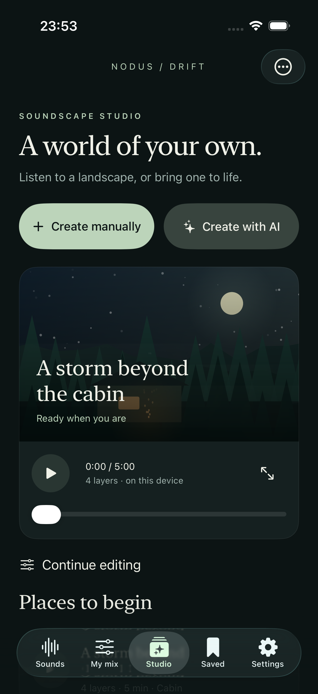
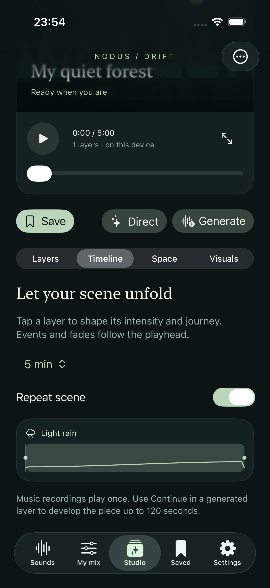
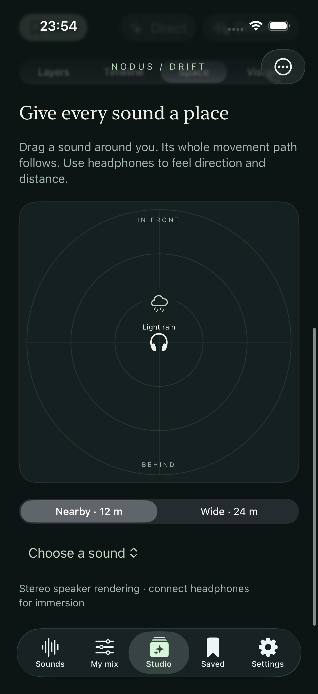
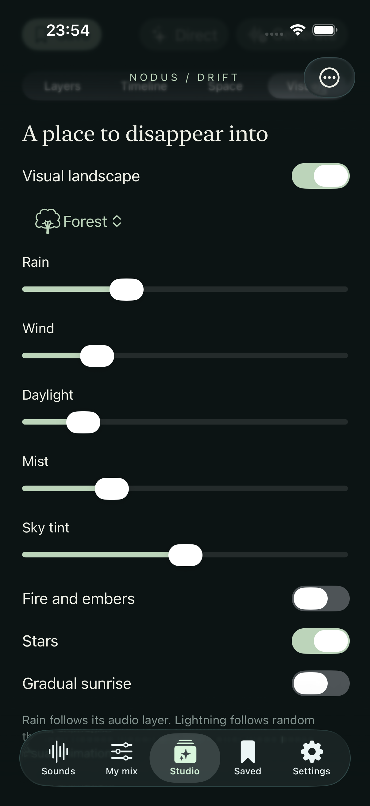

# Validación de Studio

Ejecución: 6–7 de noviembre de 2026, Europe/Madrid.
Entorno: Xcode 27.1, simulador propio «Nodus Drift Studio QA», iPhone 17 Pro,
iOS 26.5. Deployment target conservado en iOS 17. No se han repetido pruebas
físicas, siguiendo la indicación posterior del usuario.

## Pruebas

| Ejecución | Resultado |
| --- | --- |
| Auditoría del banco de audio | 81/81 archivos reconstruidos desde fuentes documentadas; integridad y controles de audio correctos. Catálogo: 89 sonidos. |
| Primera ejecución de regresión | Los 12 tests unitarios anteriores y las 9 pruebas de interfaz silenciosas pasan. Se detecta la inferencia de Foundation Models no operativa en el simulador y se mueve la atribución al encabezado visible de generación. |
| `StudioFinalValidation.xcresult` | 30 pruebas: 28 aprobadas, 2 omitidas por capacidades del simulador, 0 fallos. Incluye el recorrido previo de mezcla, guardado, meditación y favoritos. |
| `StudioRegression.xcresult` | 29 pruebas: 27 aprobadas, 2 omitidas, 0 fallos. Incluye la nueva regresión de fundidos al retirar/restaurar capas. |
| `StudioImportValidation.xcresult` | 3 pruebas aprobadas, 0 fallos, sobre la versión final de las validaciones de importación, duración real del AAC y persistencia. |
| `StudioPlaybackValidation.xcresult` | Prueba adicional aprobada: al volver del Studio al mezclador sencillo se restaura su volumen maestro guardado. |
| Release para iOS físico, sin firma | Compilación aprobada en `/private/tmp/nodus-drift-studio-release-dd`. El binario confirma plataforma iOS y mínimo 17.0; el bundle incluye el manifiesto de privacidad actualizado y no contiene pesos. |

Las dos omisiones son explícitas: StableAudioMLX no puede ejecutar inferencia en
Simulator, y Foundation Models informa disponibilidad pero su recurso de seguridad
falla con `promptTemplateNotFound`. Se conserva el diagnóstico en los adjuntos de
xcresult. No se cuentan esas dos funciones como inferencia validada en Drift.

Cobertura relevante:

- Catálogo completo, integridad de grabaciones, bucles y reposición de colas.
- Límite anterior de seis fuentes y sustitución de binaurales; temporizador y
  reproducción/pausa rápida.
- Evaluación de intensidad, fundidos y posición; eventos aleatorios reproducibles
  con semillas diferentes.
- Persistencia independiente de escenas y mezclas anteriores.
- Archivos portables con AAC, remapeo de nombres y rechazo de adjuntos alterados,
  rutas arbitrarias, versiones desconocidas y fuentes inválidas.
- Seis fuentes mono simultáneas con AVAudioEnvironmentNode y cambio de una fuente
  a estéreo durante la reproducción.
- Filtro local de habla/canto probado con tono instrumental.
- Crear escena manual, añadir lluvia, automatizar, recorrer Timeline/Space/Visuals,
  guardar y recuperar tras reiniciar la app.
- Consulta de licencias y atribuciones, y continuidad del modo manual ante la
  disponibilidad variable de Apple Intelligence.

Capturas reales de las pruebas, revisadas visualmente:

| Inicio | Línea temporal | Espacio | Visuales |
| --- | --- | --- | --- |
|  |  |  |  |

## Reproducción de las pruebas

Los xcresult y DerivedData se generan localmente, se excluyen de Git y no contienen
pesos de modelos. Sustituir el destino por un simulador disponible:

```sh
xcodegen generate --spec ios/project.yml
xcodebuild -project ios/NodusDrift.xcodeproj -scheme NodusDrift \
  -destination 'platform=iOS Simulator,name=Nodus Drift Studio QA' \
  -derivedDataPath ios/DerivedDataStudio -parallel-testing-enabled NO \
  CODE_SIGNING_ALLOWED=NO \
  -only-testing:NodusDriftTests -only-testing:NodusDriftUITests/StudioUITests test
python3 scripts/audit_audio_bank.py
git diff --check
```

El banco de audio se reconstruye con `python3 scripts/prepare_audio.py` si falta
en otro checkout; las grabaciones no se añaden a Git.

La compilación Release final se realizó con:

```sh
xcodebuild -project ios/NodusDrift.xcodeproj -scheme NodusDrift \
  -configuration Release -destination 'generic/platform=iOS' \
  -derivedDataPath /private/tmp/nodus-drift-studio-release-dd \
  -jobs 4 CODE_SIGNING_ALLOWED=NO build
```

Dos intentos anteriores fallaron con `disk I/O error` en la base de datos de
Xcode de `ios/DerivedDataStudio`; no fueron errores del código. La compilación
con un directorio nuevo fuera de esa caché terminó correctamente. No se instaló
esta compilación en un iPhone. Las entregas privadas firmadas posteriores se
documentan por separado en `docs/TESTFLIGHT.md`.

## Alcance pendiente de una versión pública

La base de viabilidad de inferencia procede de Reader, como pidió el usuario.
No se han vuelto a medir consumo, calidad musical, continuación/inpainting ni
experiencia con auriculares físicos dentro de Drift. La nueva integración nativa
de Foundation Models compila, pero no ha producido una escena en este simulador.
Tampoco se han probado con una cuenta real las descargas de modelos desde la UI
de Drift; sus URLs, revisión y hashes proceden del instalador validado en Reader.
La revisión de Apple y las condiciones de registro/licencia de la entidad
distribuidora siguen siendo decisiones externas a las pruebas de código.

## Paisajes fotorrealistas · compilación 10

`PhotographicLandscapesFinal.xcresult`: **7 pruebas aprobadas, 0 fallos y 0
omisiones**, el 7 de noviembre. Cinco pruebas unitarias validan las siete
imágenes incluidas, la disposición de uniforms, el shader Metal real, el
movimiento de agua, la determinación de un fotograma pausado, el color sRGB,
la automatización visual y la supresión de relámpagos con Reducir movimiento.
Las otras dos pruebas recorren los siete paisajes y su pausa, y crean/guardan
una escena pasando por Timeline, Space y Visuals.

Se inspeccionaron las siete capturas dentro del simulador y una grabación de
seis segundos del fuego y el bosque de la cabaña. La primera revisión detectó
colores incorrectos al pasar un thumbnail CGImage a MTKTextureLoader. Se corrigió
cargando el JPEG directamente como textura sRGB; la prueba de color utiliza
la misma función que producción. Las capturas finales se conservan en
`screenshots/studio/landscapes/`; las ejecuciones anteriores con color incorrecto
no se presentan como evidencia final.

Las capturas de XCTest documentan orientación vertical. El test solicitó rotación,
pero el simulador mantuvo el layout vertical: no se cuenta como validación de
orientación horizontal. También se instaló el mismo ejecutable Debug del renderer
en un simulador aislado iPad Air de 11 pulgadas (M3), iOS 26.5; se revisó la cabaña
en vertical y su encuadre, ventana, hogar e iluminación. La captura se conserva
en `screenshots/studio/landscapes/ipad-cabin.jpg`. La composición usa aspect-fill
en ambos ejes. Esta comprobación adicional no añade casos al recuento de XCTest.

El botón de créditos y la numeración se añadieron después de la ejecución de
interfaz; su inclusión y compilación se verifican en el archive Release. No se
han medido batería, FPS sostenidos ni temperatura en un iPhone para este cambio.
Las limitaciones de inferencia documentadas arriba siguen vigentes.

Detalles del renderer, límites y procedencia: [LANDSCAPES.md](LANDSCAPES.md).
Resumen original de XCTest: [LANDSCAPE_TEST_RESULTS.json](LANDSCAPE_TEST_RESULTS.json).

## Meditación, animación y marca · compilaciones 11–12

- `StarterCrashReproduction.xcresult`: reproduce la ruta de audio de los tres
  starters antes de los cambios defensivos; 1 prueba aprobada sin reproducir el cierre.
- `MeditationMotionValidation.xcresult`: 34 aprobadas, 2 omitidas por las limitaciones
  de IA ya documentadas y 1 fallo de localización del selector duplicado en XCTest.
- `MeditationChoiceFinal.xcresult`: el recorrido completo de mezcla real, paisaje
  de cabaña, pausa visual independiente, cambio a Nodi y persistencia pasa después
  de separar los identificadores de accesibilidad.
- `IOS27CabinAndBrandValidation.xcresult`: 9 pruebas unitarias aprobadas, incluido
  audio real y GPU; las 2 pruebas UI fallan al localizar TabBar en el perfil Duo
  suministrado por ese runtime. No se presentan como validación UI aprobada.
- `BrandFinalValidation.xcresult`: recorrido de las cinco pestañas aprobado en
  iPhone 17 Pro/iOS 26.5, con capturas y revisión visual de Nodi al mismo tamaño.

Se conservan los resúmenes originales JSON en esta carpeta. La nueva comprobación
GPU mide fotogramas completados en una ventana real durante actualizaciones
repetidas, pausa y reinserción. Otra prueba aísla la forma de las llamas en el
hogar y la caída de lluvia, sin movimiento de otros elementos. Se revisó además
una grabación de seis segundos del renderer con lluvia más visible. No se ha
instalado ni probado esta compilación en el iPhone físico del usuario.

El usuario identificó el primer paisaje de cabaña como origen del cierre. App
Store Connect no aportó un informe, pero se pudo copiar el reporte ya guardado
en systemCrashLogs sin abrir ni probar la aplicación. La simbolicación con el
dSYM de la compilación 10 identifica un abort en AVAudioPlayerNode al arrancar
un reproductor. La compilación 12 corrige esa ruta y añade pruebas de recuperación;
el informe no incluye el motivo exacto del estado inválido del grafo. Detalles: [BUILD12_FIXES.md](BUILD12_FIXES.md).

## Build 12 adaptive scenes

The current source adds 22 photographic backgrounds, animal/object atlases and
native compositing. `AdaptiveSceneValidation.xcresult` passed ten tests before the
final six additional plates; `AdaptiveFinalRegression.xcresult` subsequently ran
all 41 unit tests against the complete artwork: 39 passed and two AI simulator
probes were skipped. This includes all 22 plates decoding and rendering, real
completed onscreen GPU frames, isolated rain/fire motion, atlas wolf/track
rendering, every catalogue ID's recipe, portable scene persistence, six concurrent
spatial sources, interrupted audio startup and disconnected-player handling.
Its UI run passed brand checks for all five tabs, personalized snow/wolf and
car/wipers compositions in portrait and native-requested horizontal, plus real
playback/open/close of all three Studio starters. The appearance-choice UI test
failed after its controls auto-hid during screenshot collection; it is not counted
as passed in that result. Earlier complete choice/persistence coverage remains
in `MeditationChoiceFinal.xcresult`.

The iOS 27.1 Duo expanded simulator passed ten rendering/composition tests in
`DuoResizableValidation.xcresult`. Its window geometry probe explicitly skipped
because UIKit returns UISceneErrorDomain 101 for programmatic orientation in the
current resizable windowing mode. The catalogue UI automation did not pass: its
search results were below the initial visible viewport and the later keyboard
submission attempt was unreliable. Those failures are retained in the summaries;
they do not establish full Duo editing-flow coverage. The clean expanded
snow/wolf/footprints renderer was separately inspected using Device Hub Open and
captured natively at 2853 × 2007. No physical iPhone tests were run.

Some app-region XCTest screenshots crop incorrectly after rotation on the supplied
runtimes. UI capture uses `XCUIScreen.main.screenshot()` for subsequent runs;
native `simctl io` screenshots and Device Hub inspection provide visual evidence.

`MeditationControlsVerified.xcresult` subsequently passed the complete real mix
appearance test on a freshly booted iPhone simulator: Cabin interpretation,
independent visual pause while real audio remains active, switching to Nodi and
restoring Nodi after app relaunch. The harness now refreshes the five-second
controls timer after taking its screenshot. The release app source is unchanged
from the verified archive fingerprint. Additional keyboard-submission experiments
in `AdaptiveControlsFinal` and Duo UI checks failed at UI event synthesis/results
visibility; cleanup hung and those test processes were terminated after their
test bodies finished. They are not counted as successful runs.

The expanded Duo car/rain/wipers fixture was also captured natively at
2853 × 2007 and inspected for full-surface rendering and clean top-left branding:
[duo-open-car.png](../../screenshots/studio/adaptive/duo-open-car.png).
