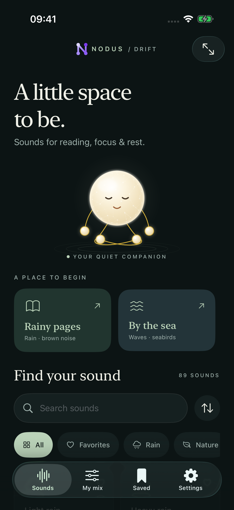
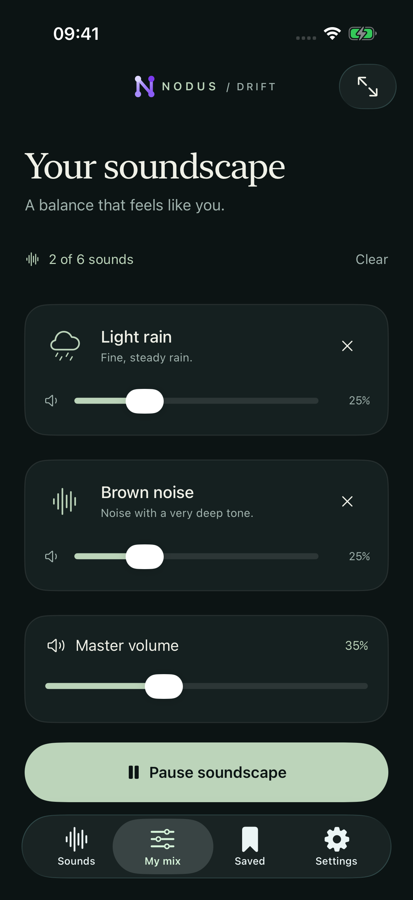
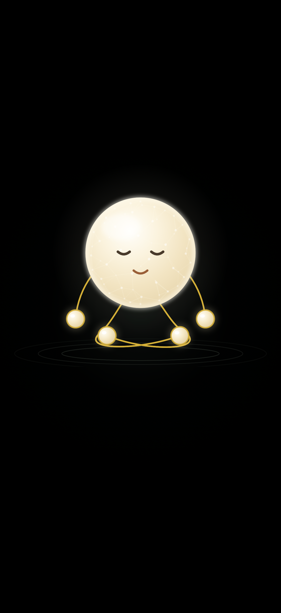
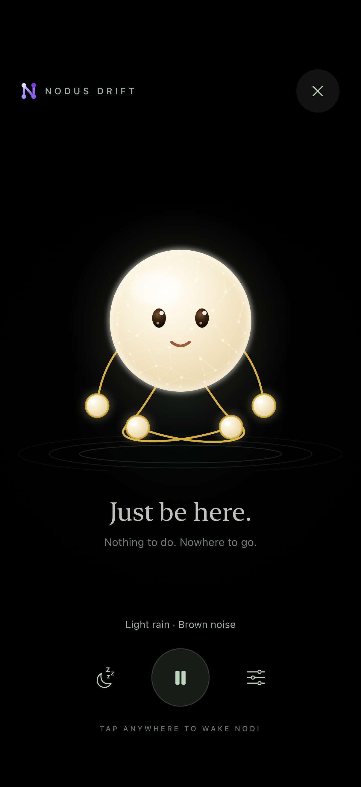
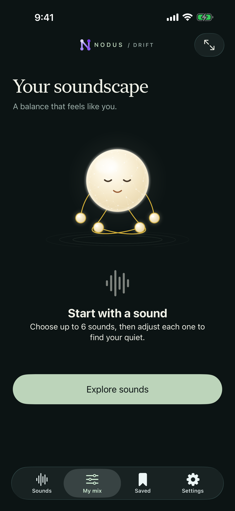
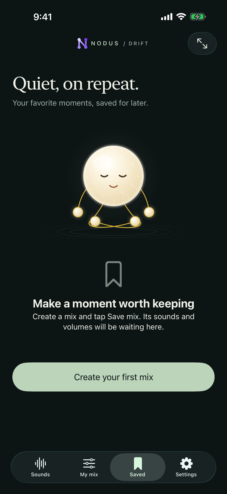
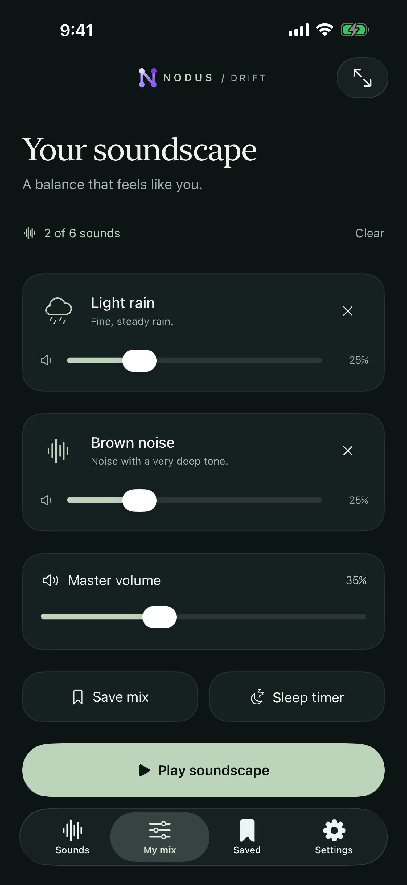
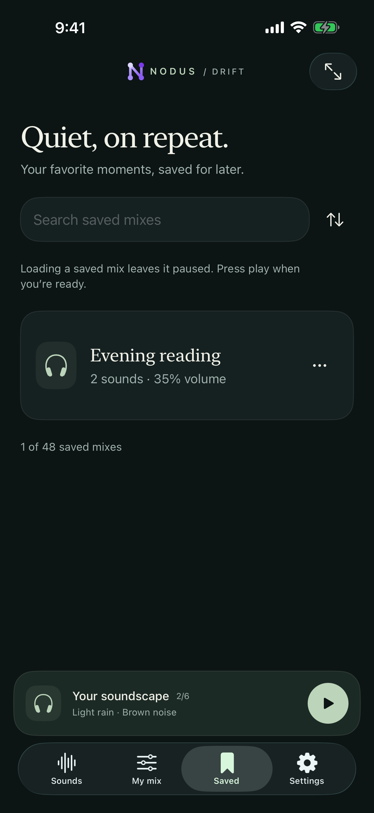

# Real simulator captures

These are unretouched captures of the native application. The main gallery is from
an iPhone 17 Pro on iOS 26.3.1. The device variants include an iPhone SE (3rd generation)
on iOS 18.2 and an iPad mini (A17 Pro) on iOS 26.3.1. Landscape images retain Apple's
native screenshot orientation metadata.

| Home | Playing mix |
| --- | --- |
|  |  |

| Nodi resting, controls hidden | Nodi awake after a tap |
| --- | --- |
|  |  |

- [Saved mixes](03-saved.png)
- [Meditation controls](04-meditation-controls.png)
- [Settings](07-settings.png)
- [Rain library and volume controls](08-sound-library.png)
- [Favorites](09-favorites.png)
- [Small iPhone](10-device-portrait-se.png)
- [Small iPhone, landscape meditation](13-device-meditation-landscape-se.png)
- [iPad](10-device-portrait-ipad.png)
- [iPad, landscape meditation](13-device-meditation-landscape-ipad.png)
- [Internal TestFlight build 1 is Testing](14-testflight-build1.jpg)

## Store media uploaded October 9, 2026

The [store media record](app-store/README.md) lists the six selected images in each
device gallery. Additional iPhone 17 Pro Max and iPad Pro 13-inch M5 images are
native XCTest screen captures at their original dimensions, with no visual edits.

- [Saved TestFlight beta description](15-testflight-description.jpg)
- [Saved What to Test instructions](16-testflight-testing-notes.jpg)
- [Medium iPhone upload](17-app-store-iphone-screenshots.jpg)
- [13-inch iPad upload](18-app-store-ipad-screenshots.jpg)
- [Large iPhone upload](19-app-store-iphone-large-screenshots.jpg)
- [Description and medium iPhone gallery, with page context](20-app-store-metadata-proof.jpg)

## Current version 0.1.0

- [Corrected App Store draft version](21-app-store-version-0.1.0.jpg)
- [Only active internal group build, 0.1.0 (2)](22-testflight-0.1.0-active.jpg)
- [Saved instructions for 0.1.0 (2)](23-testflight-0.1.0-notes.jpg)

Earlier browser proofs retain their actual historical version labels.

The October 9 build 4 interaction fixes have fresh silent native UI captures:
24-card-activation.png, 25-stable-filters.png, 26-settings-aligned.png and
27-moodist-license.png and 32-deep-filter-results.png. The equivalent iPad captures are in silent-ipad/.
No audio was played to produce these captures. The centered icon is the actual
1024px AppIcon asset in ios/NodusDrift/Assets.xcassets/AppIcon.appiconset/.

## Saved layout parity — build 5

Fresh silent iPhone 17 Pro Max captures from the focused Saved regression test:

| My mix | Saved |
| --- | --- |
|  |  |
|  |  |

The test compares heading scale, Nodi size, action-button dimensions and card
width/height across both tabs, then saves and loads a mix without pressing Play.
The corresponding iPad captures are under silent-ipad/. Historical App Store
captures above retain their actual uploaded image contents.

- [Saved build 5 instructions](40-testflight-0.1.0-5-notes.png)
- [Current internal TestFlight beta, 0.1.0 (5)](41-testflight-0.1.0-5-active.png)

## Replacement audio bank — build 6

These captures come from the successful silent iPhone and iPad tests:

- [Sound activations, iPhone](43-build6-iphone-sounds.png)
- [Settings, iPhone](44-build6-iphone-settings.png)
- [Settings, iPad](45-build6-ipad-settings.png)
- [Audio permissions and source credits, iPhone](46-build6-iphone-audio-credits.png)
- [Audio permissions and source credits, iPad](47-build6-ipad-audio-credits.png)

The new bank keeps all 89 options. No audio was played for these captures.

- [Saved build 6 notes](48-testflight-0.1.0-6-notes.jpg)
- [Private TestFlight beta 0.1.0 (6), Testing](49-testflight-0.1.0-6-active.jpg)
